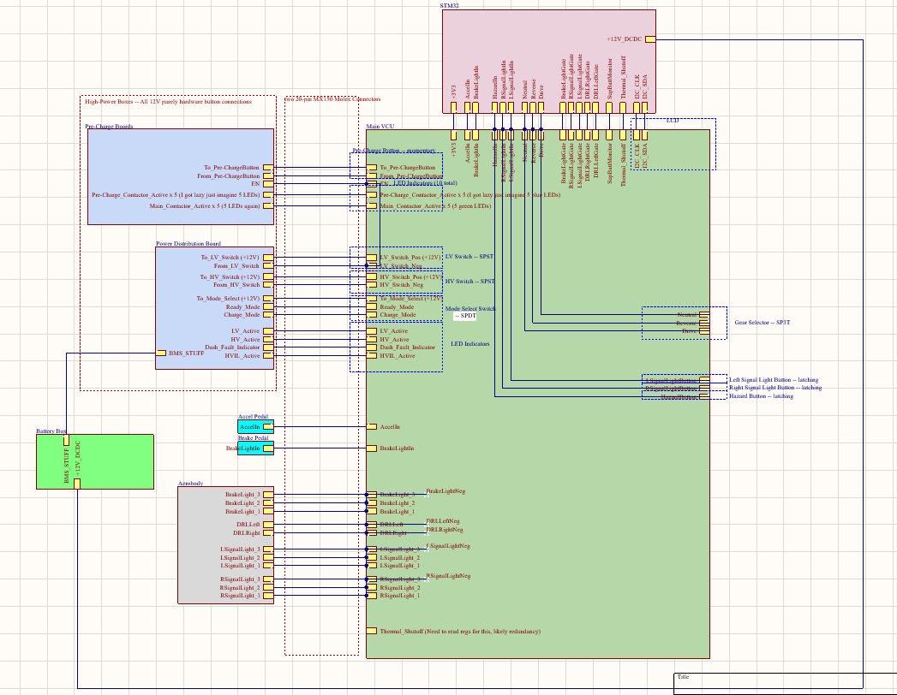

# Sunstang Driver Controls 2027

Driver Controls / Vehicle Control Unit (VCU) PCB for **Western Sunstang**, 2027 car.

This repo is the home base for the Driver Controls sub-team, and it's where new general members get onboarded. It holds both halves of the project:

| Track | Folder | You'll work on |
|-------|--------|----------------|
| ⚡ **Hardware** | [`hardware/`](hardware/) | Part availability → current consumption → schematic → PCB layout → bring-up |
| 💾 **Firmware** | [`firmware/`](firmware/) | STM32 C + FreeRTOS: pedals, lighting, vehicle state machine, CAN, display |

> **New member?** Read [Getting started](#getting-started) below, then go to the onboarding guide for your track.

---

## What's new for 2027

The previous board ([Sunstang-VCU-2026](https://github.com/hanjing06/Sunstang-VCU-2026)) was a carrier board for an **STM32 Nucleo-F302R8** dev board, running the [VCU_2025](https://github.com/uixt/VCU_2025) firmware. For 2027 we're **putting the STM32 chip directly on our own PCB**.

That means the board now has to do everything the Nucleo did for us:

| Was handled by the Nucleo | Now on our PCB |
|---------------------------|----------------|
| 3.3 V regulator | 12 V → 3.3 V power stage (buck and/or LDO), input protection |
| Clock (8 MHz from ST-LINK MCO) | 8 MHz HSE crystal and load caps (CAN needs an accurate clock) |
| ST-LINK programmer/debugger | SWD debug connector, plus an external ST-LINK |
| Reset button, BOOT0 strap | NRST circuit, BOOT0 pull-down |
| Decoupling, VDDA filtering | 100 nF per VDD pin, bulk caps, VDDA ferrite and filter |
| USB virtual COM port | UART debug header |

Firmware is affected too. VCU_2025 runs from the chip's internal HSI oscillator on Nucleo default pins. The 2027 firmware moves to the HSE crystal, a pin map taken from **our** schematic, and SWD programming through our own header. See [`hardware/docs/nucleo-to-chip-migration.md`](hardware/docs/nucleo-to-chip-migration.md).

**Target MCU (planned):** STM32F302R8T6 (LQFP-64). This is the same chip that's on the Nucleo, so last year's work carries over. *Update this line if the part changes.*

---

## What the board does

The VCU is the low-voltage brain of the car. It reads the driver's controls, runs the vehicle state logic, and drives the 12 V lights and indicators.

<p align="center">
  
  <br><em>2026 system diagram (reference; the 2027 version will go in docs/images)</em>
</p>

| Subsystem | Signals |
|-----------|---------|
| **Power & HV control** | LV/HV switches, pre-charge button, pre-charge & main contactor indicators, HV/LV/HVIL active, BMS interface |
| **Driver inputs** | Accelerator pedal (ADC), brake pedal |
| **Mode & gear** | Ready / Charge mode (SPDT), gear selector: Neutral / Reverse / Drive |
| **Lighting** | Brake lights, left/right DRL, left/right turn signals, hazard (latching), driven through low-side MOSFETs |
| **Safety** | Thermal shutoff, dash fault indicator, pre-charge verification before main contactor |
| **Comms** | CAN bus, I²C character LCD, UART debug |

Two voltage domains: the **12 V automotive** domain (switches, lights, contactor indicators) and the **3.3 V logic** domain (MCU). Every signal crossing between them is conditioned. See [`docs/system-overview.md`](docs/system-overview.md).

---

## Repository layout

```
Sunstang-DriverControls-2027/
├── README.md                  ← you are here
├── CONTRIBUTING.md            ← branching, PRs, commit style
├── docs/                      ← shared, system-level docs (both tracks)
│   ├── onboarding.md          ← start here: accounts, tools, first week
│   ├── system-overview.md     ← what the VCU does, voltage domains, startup sequence
│   ├── interface-control.md   ← THE pin map: contract between hardware & firmware
│   ├── images/
│   └── reference/             ← notes on the 2026 board & VCU_2025 firmware
│
├── hardware/
│   ├── README.md
│   ├── docs/                  ← part selection, power budget, migration, checklists, bring-up
│   ├── bom/                   ← parts-tracker.csv (Step 1), power-budget.csv (Step 2), BOMs
│   ├── datasheets/            ← links to datasheets (not PDFs)
│   ├── kicad/                 ← KiCad 9 project (hierarchical sheets)
│   ├── libraries/             ← project-local symbols / footprints / 3D models
│   ├── simulation/            ← LTspice / KiCad sim of input conditioning, power
│   └── fabrication/           ← Gerbers / drill / pos files per revision
│
├── firmware/
│   ├── README.md
│   ├── docs/                  ← architecture, state machine, coding standards, flashing
│   ├── DriverControls/        ← STM32CubeIDE project (generated HAL + FreeRTOS, .ioc)
│   ├── app/                   ← OUR application code (kept out of generated files)
│   │   ├── inc/               ← module interfaces (.h), already drafted
│   │   └── src/               ← module implementations (.c), to be written
│   ├── drivers/               ← device drivers (LCD, CAN transceiver helpers)
│   ├── examples/              ← onboarding exercises (run on a Nucleo first)
│   ├── tests/                 ← host-side unit tests for app/ logic
│   └── tools/                 ← scripts (CAN DBC, log parsing, etc.)
│
└── .github/                   ← issue & PR templates
```

**The most important file in this repo is [`docs/interface-control.md`](docs/interface-control.md).** It's the single table that says which signal goes to which MCU pin. Hardware owns it and firmware reads it. Any change to it needs a PR reviewed by **one member from each track**.

---

## Getting started

1. **Get access.** Ask the Driver Controls Lead to add you to the GitHub repo and the team channel.
2. **Read** [`docs/onboarding.md`](docs/onboarding.md) and [`docs/system-overview.md`](docs/system-overview.md). Both tracks should read both.
3. **Pick your track:**
   - Hardware → [`hardware/docs/onboarding.md`](hardware/docs/onboarding.md)
   - Firmware → [`firmware/docs/onboarding.md`](firmware/docs/onboarding.md)
4. **Do the starter task** for your track (listed in its onboarding guide), then pick up an issue labelled `good first issue`.
5. **Read** [`CONTRIBUTING.md`](CONTRIBUTING.md) before opening your first PR.

### Tools

| | Hardware | Firmware |
|---|---|---|
| Main tool | [KiCad 9](https://www.kicad.org/download/) | [STM32CubeIDE](https://www.st.com/en/development-tools/stm32cubeide.html) (includes CubeMX) |
| Also useful | Digi-Key / Mouser / LCSC accounts, LTspice, a multimeter | Nucleo-F302R8, ST-LINK, a USB-CAN adapter |
| Everyone | Git + a GitHub account | |

---

## Project roadmap

| Phase | Hardware | Firmware |
|-------|----------|----------|
| **0. Onboarding** | Distributor accounts, review the 2026 schematic | Blinky / ADC / CAN examples on a Nucleo, read VCU_2025 |
| **1. Parts & availability** | Check stock, lifecycle and alternates for every part → `parts-tracker.csv` | Write the state machine spec, confirm CAN messages |
| **2. Current consumption** | Per-rail power budget → choose regulator, fuse, trace widths → `power-budget.csv` | Port VCU_2025 logic into `app/` modules on the Nucleo |
| **3. Schematic** | Hierarchical schematic, freeze ICD, design review | Build `.ioc` from the pin map (HSE clock) |
| **4. Layout** | Placement, routing, DRC, layout review | Develop app modules on Nucleo + breadboard |
| **5. Fab & assembly** | Order PCB & parts, assemble | Host unit tests, bench test with simulated inputs |
| **6. Bring-up** | Power-on checklist, rail checks | Port to the real board, flash over SWD, validate each I/O |
| **7. Integration** | Harness and in-car testing | Full startup sequence and CAN with the rest of the car |

**Hardware members don't start in KiCad.** The first job is checking that every part is buyable (Step 1), then adding up the current draw (Step 2). Only then do we draw the schematic. See [`hardware/docs/onboarding.md`](hardware/docs/onboarding.md).

Progress is tracked in GitHub Issues / Projects.

---

## Contacts

| Role | Name |
|------|------|
| Driver Controls Lead | Hanjing Lin |
| Hardware track lead | *TBD* |
| Firmware track lead | *TBD* |

---

## References

- Previous board: [hanjing06/Sunstang-VCU-2026](https://github.com/hanjing06/Sunstang-VCU-2026) (notes: [`docs/reference/2026-vcu.md`](docs/reference/2026-vcu.md))
- Previous firmware: [uixt/VCU_2025](https://github.com/uixt/VCU_2025) (notes: [`docs/reference/2025-firmware.md`](docs/reference/2025-firmware.md))
- [STM32F302R8 product page](https://www.st.com/en/microcontrollers-microprocessors/stm32f302r8.html): datasheet, reference manual (RM0365), errata
- [AN4206: Getting started with STM32F3 hardware development](https://www.st.com/resource/en/application_note/an4206-getting-started-with-stm32f3-series-hardware-development-stmicroelectronics.pdf): **required reading for the chip-down design**
- [Nucleo-F302R8](https://www.st.com/en/evaluation-tools/nucleo-f302r8.html): the 2026 board's MCU, and still the best way to prototype firmware
